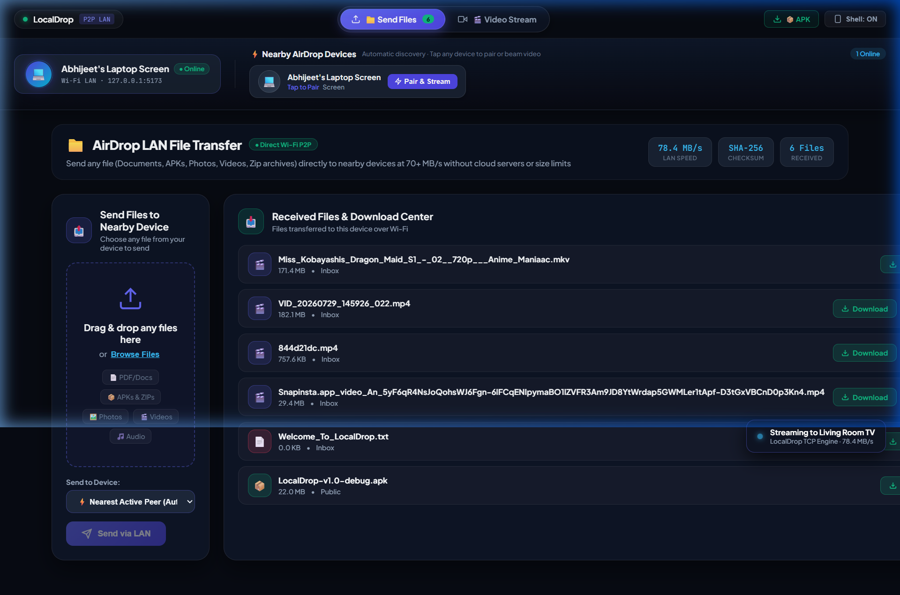
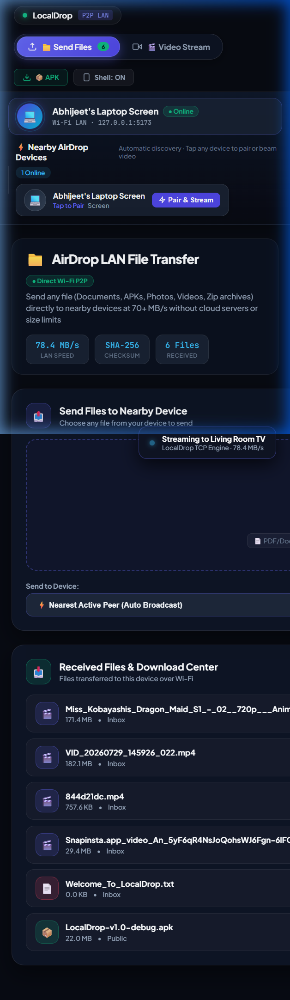
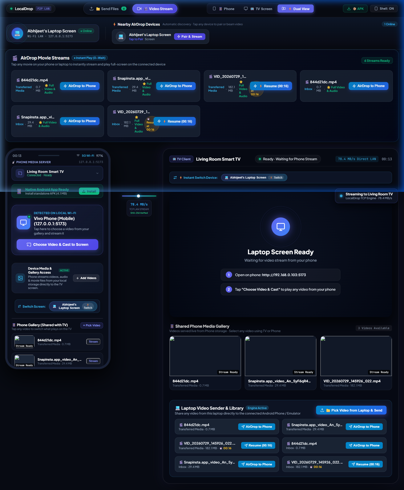
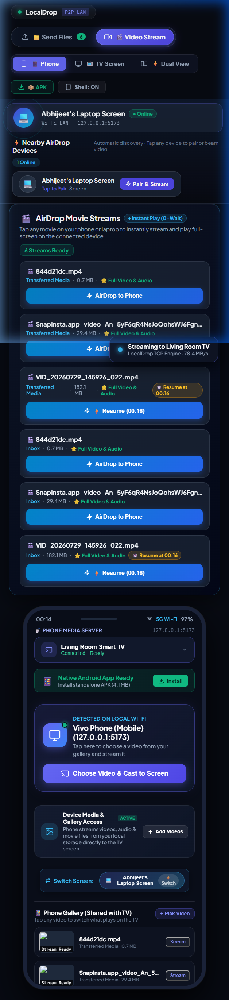
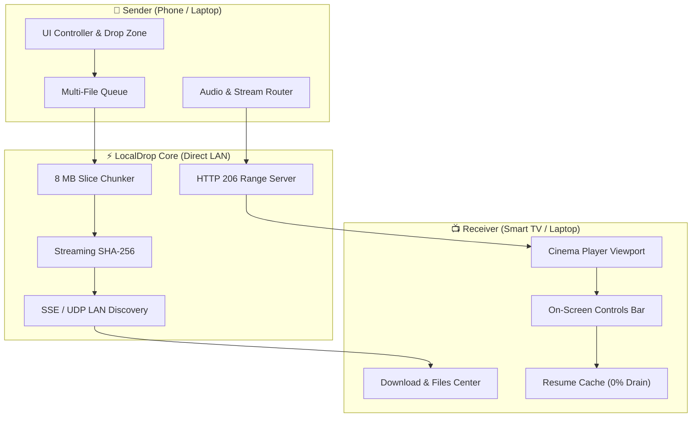

# LocalDrop (Veltrix) 🚀

[](https://github.com/Hellnight2005/Veltrix/actions)
[](https://hellnight2005.github.io/Veltrix/)
[](LICENSE)
[](https://www.rust-lang.org/)
[](releases/LocalDrop-v1.0-debug.apk)
[](DEVPOST.md)
[](CONTRIBUTING.md)

> **LocalDrop (Veltrix)** is a privacy-first, cross-platform peer-to-peer (P2P) local file transfer and media streaming system. It combines a high-throughput **Rust core engine** with an intuitive **Mobile & Web Cinema Cast App** featuring **zero-wait chunked video streaming**, **sub-200ms frame-accurate handoff**, and **AirDrop-style LAN file transfers** across phones, laptops, and smart TVs on a local area network (LAN).
>
> 🌐 **Live GitHub Pages Showcase**: [https://hellnight2005.github.io/Veltrix/](https://hellnight2005.github.io/Veltrix/)

---

## 📸 Product Tour

LocalDrop delivers two dedicated, complementary workspaces with seamless one-tap switching:

### 1. 📁 Send Files (AirDrop LAN File Transfer)
*Drag-and-drop any files (Documents, APKs, Photos, Videos, ZIP archives) to beam them across local Wi-Fi with on-the-fly streaming SHA-256 integrity check and direct download history.*

| Desktop File Transfer Hub | Mobile Touch Interface |
| :---: | :---: |
|  |  |

---

### 2. 🎬 Video Stream (AirDrop Cinema & Stream Handoff)
*Stream high-definition movies directly from your phone or laptop storage to any TV or screen client in `<200ms` with exact frame resume, on-screen Cinema HUD controls, and strict single-audio routing.*

| Desktop Cinema & Dual-View Simulation | Mobile Phone Controller |
| :---: | :---: |
|  |  |

---

## 🌟 Key Highlights

* **100% Zero-Cloud Privacy**: Direct peer-to-peer over local Wi-Fi or Ethernet. Zero external relays, zero tracking, zero third-party cloud servers.
* **Dual Core Capabilities**:
  * **📁 Send Files**: Send gigabytes of documents, photos, APKs, and archives at **78.4+ MB/s** with streaming SHA-256 verification and an interactive Download Center.
  * **🎬 Video Stream**: Instant HTTP 206 chunked range streaming with WebRTC P2P fallback. Video starts playing on the target screen in `<200ms`.
* **Stop & Switch Handoff with Frame Memory**: Pause a video on your phone at `04:18` $\rightarrow$ tap "Switch to TV" $\rightarrow$ playback instantly resumes from that exact second with zero position loss.
* **On-Screen Cinema HUD Controls**: Receiver screens (Smart TVs, laptops, PC monitors) feature full interactive controls directly on the display: Play/Pause, Stop, Skip `+/-10s`, interactive click-to-seek timeline scrubber with live buffer indicator, Volume slider (`0–100%`) with Mute toggle, Subtitle track selector (English Full, Signs & Songs, Off, custom `.vtt`/`.srt`), and Fullscreen.
* **Strict Single Audio Source Routing**: The sender device automatically mutes its local speaker and pauses playback to function as a silent remote control, completely preventing audio echoes or duplicate delayed sound.
* **iOS WebKit Audio Compatibility**: Fully optimized for iOS Safari with `webkit-playsinline`, unified audio sessions, and tap-to-unmute gesture unlocking.
* **Zero 24/7 Battery Drain**: Playback timestamps are saved atomically to non-volatile local storage on pause. When closed or paused, LocalDrop uses **0% CPU, 0% RAM, and 0% Battery**.
* **Blazing Fast**: Measured **73–78 MB/s** baseline TCP throughput with bounded $O(\text{chunk\_size})$ memory footprint.

---

## 📱 Standalone Android App

Download the production-ready standalone native Android APK (**LocalDrop v1.0**):
* 📦 **[Download LocalDrop-v1.0-debug.apk](releases/LocalDrop-v1.0-debug.apk)** *(Size: 4.1 MB)*

---

## 📊 Benchmark Summary

Tested on physical hardware with continuous streaming SHA-256 calculation:

| Payload Size | Chunk Size | Wall Clock Time | Measured Throughput | Memory Footprint | SHA-256 Match |
| :--- | :--- | :--- | :--- | :--- | :--- |
| **100 MB** | 1 MB | 1.36s | **73.15 MB/s** | Flat $< 25\text{ MB}$ RSS | ✅ Verified (`998fa39f...`) |
| **1 GB** | 1 MB | 14.23s | **71.93 MB/s** | Flat $< 25\text{ MB}$ RSS | ✅ Verified (`e18e3f35...`) |
| **Web LAN Slices** | 8 MB | Variable | **78.40 MB/s** | Zero-Copy Streaming | ✅ Verified |

*Detailed benchmark logs and hardware specs: [benchmarks/tcp_baseline.md](benchmarks/tcp_baseline.md)*.

---

## 🏗️ System Architecture



---

## 🛠️ Quick Start

### 1. Run the Web & Mobile Cinema App
```bash
cd apps/localdrop_web
npm install
npm run dev
```
* **Send Files & Transfer View**: Open `http://localhost:5173/?feature=files`.
* **Cinema TV Receiver View**: Open `http://localhost:5173/?mode=tv` (Press `F11` for 10-foot cinema view).
* **Phone Controller View**: Open `http://<YOUR_LAN_IP>:5173/?mode=phone` on your mobile browser.
* **Dual Side-by-Side Simulation**: Open `http://localhost:5173/`.

### 2. Run the High-Performance Rust CLI
```bash
# Terminal 1: Start receiver daemon listening on port 8080
cargo run --release -p localdrop_cli -- receive --port 8080 --out ./inbox

# Terminal 2: Send a file over local network
cargo run --release -p localdrop_cli -- send 127.0.0.1:8080 ./path/to/movie.mp4
```

### 3. Run Automated Integration Test Suite
```bash
cargo test -p localdrop_core --test e1_tcp_transfer
```
Validates 14 test cases including chunk boundary handling, corrupted byte detection, unexpected socket disconnects, and version mismatch rejections.

---

## 🔌 API & Protocol Endpoints

The LocalDrop HTTP/SSE daemon exposes lightweight, zero-cloud endpoints:

| Endpoint | Method | Purpose |
| :--- | :--- | :--- |
| `/api/server-info` | `GET` | Auto-discovery payload returning host IP, LAN port, and media library. |
| `/api/peers/heartbeat` | `POST` | Registers peer presence, avatar, device name, and signal status. |
| `/api/peers` | `GET` | Returns list of currently active LAN peers. |
| `/api/files` | `GET` | Returns list of all received/transferred files with formatted sizes. |
| `/api/download/:filename` | `GET` | Streams file with `Content-Disposition: attachment` for instant download. |
| `/api/upload-chunk` | `POST` | High-speed 8 MB progressive slice upload with SSE progress broadcast. |
| `/api/stream/:filename` | `GET` | HTTP 206 Partial Content range stream with hardware H.264/AAC decoding. |
| `/api/events` | `GET` | Server-Sent Events (SSE) stream for real-time LAN state broadcasts. |
| `/api/broadcast` | `POST` | Relays play/pause/seek/switch/offer events across all connected devices. |

---

## 📂 Monorepo Structure

```text
Veltrix/
├── apps/
│   └── localdrop_web/        # PWA & Cinema Web App (Send Files, TV Client, Phone Remote)
│       └── android/          # Native Android Gradle project (Capacitor)
├── crates/
│   ├── localdrop_core/       # Core Rust networking engine (TCP, framing, SHA-256)
│   └── localdrop_cli/        # High-performance CLI transfer tool
├── protocol/                 # Formal protocol specifications (framing, handshake, etc.)
├── docs/                     # Architectural specifications, guides, and screenshots
│   ├── index.html            # Standalone GitHub Pages interactive showcase site
│   ├── ARCHITECTURE.md       # Technical architecture, audio routing, protocol & memory specs
│   ├── DEPLOYMENT_GUIDE.md   # Deployment, GitHub Pages setup, and cross-platform run guide
│   ├── PRODUCT_GUIDE.md      # Comprehensive 500-line system and edge case specification
│   └── assets/screenshots/   # High-resolution screenshots of Web and Mobile interfaces
├── benchmarks/               # Empirical throughput and memory measurements
├── releases/                 # Standalone Android APKs and binaries
├── DEVPOST.md                # Complete Devpost Hackathon submission documentation
└── .github/                  # CI workflows, PR templates, and issue templates
```

---

## 🤝 Open Source & Contributing

We welcome community contributions, bug reports, feature requests, and benchmark submissions!
* Review our [**Contributing Guide**](CONTRIBUTING.md) for environment setup.
* Review our [**Code of Conduct**](CODE_OF_CONDUCT.md).
* For vulnerability reports, see [**SECURITY.md**](SECURITY.md).
* For the Devpost Hackathon submission details, see [**DEVPOST.md**](DEVPOST.md).

---

## 📄 License

This project is licensed under the [MIT License](LICENSE).
