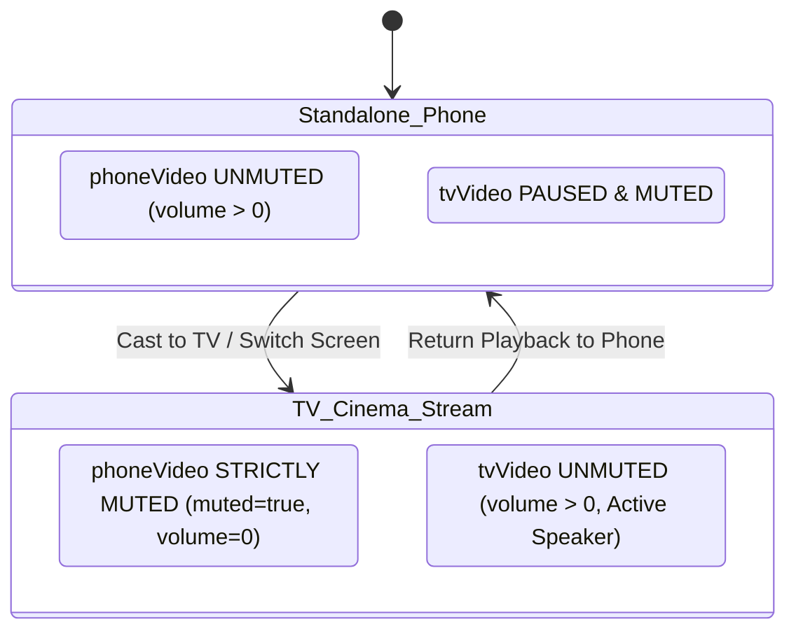

# LocalDrop (Veltrix) — System Architecture & Technical Specification

> **LocalDrop** is a privacy-first, cross-platform peer-to-peer (P2P) local file transfer and media streaming system. It combines a high-throughput **Rust core engine** with a mobile-first **Web PWA and Android Native Client**, delivering **zero-wait chunked video streaming**, **sub-200ms frame-accurate device handoff**, and **AirDrop-style LAN file transfers** across phones, laptops, and smart TVs on a local area network (LAN).

---

## 1. High-Level Architecture Overview

The system is organized into three complementary layers:

```
+-------------------------------------------------------------------------------------------------+
|                                    PRESENTATION LAYER                                           |
|                                                                                                 |
|   +---------------------------------------------+   +-----------------------------------------+ |
|   |         LocalDrop Mobile Web / PWA          |   |          Android Native Client          | |
|   |  * Dual Mode Switcher (Files vs Cinema)     |   |  * Capacitor / WebView Container        | |
|   |  * Drag-and-Drop Drop Zone & Queue          |   |  * Local Storage & Gallery Integration  | |
|   |  * On-Screen Cinema HUD (Seek, Vol, Subs)   |   |  * Standalone APK (LocalDrop-v1.0)      | |
|   |  * Single-Audio Routing Engine (Zero Echo)  |   |  * Zero 24/7 Background Battery Drain   | |
|   +---------------------------------------------+   +-----------------------------------------+ |
+------------------------------------------------▲------------------------------------------------+
                                                 │ REST API / Server-Sent Events (SSE) / WebRTC
+------------------------------------------------▼------------------------------------------------+
|                                  LOCAL NETWORK DAEMON                                           |
|                                                                                                 |
|  * HTTP 206 Partial Content Range Streaming Server (Hardware H.264 / AAC Direct Play)           |
|  * Progressive 8 MB Chunk Slice Engine with SHA-256 Checksums                                   |
|  * SSE Real-Time LAN Event Bus (/api/events, /api/broadcast)                                    |
|  * Static Asset Host & P2P Download Center (/api/download/:filename)                           |
+------------------------------------------------▲------------------------------------------------+
                                                 │ Async Socket IPC / Tokio Pipelines
+------------------------------------------------▼------------------------------------------------+
|                                     RUST CORE ENGINE                                            |
|                                                                                                 |
|  +-------------------------------------------------------------------------------------------+  |
|  | localdrop_cli: CLI Runner, daemon controller, terminal progress telemetry                 |  |
|  +-------------------------------------------------------------------------------------------+  |
|  | localdrop_core:                                                                           |  |
|  |  * Protocol Framing: 4-byte Big-Endian length-prefix, 16 MiB frame maximum                |  |
|  |  * Transport Layer: Tokio asynchronous TCP socket engine (QUIC-ready transport trait)     |  |
|  |  * Streaming Transfer: Bounded 1 MB chunking, on-the-fly streaming SHA-256 calculation   |  |
|  |  * Resumable Transfer: Binary .part.manifest bitset tracker, missing-chunk reconciliation |  |
|  |  * Path Sanitizer: Defense against directory traversal (..), path separators, reserved   |  |
|  |    Windows names (CON, NUL, AUX, COM1-9, LPT1-9)                                          |  |
|  |  * Discovery Registry: mDNS service advertising (_localdrop._tcp), UDP broadcast beacon |  |
|  +-------------------------------------------------------------------------------------------+  |
+-------------------------------------------------------------------------------------------------+
```

---

## 2. Core Capabilities: Dual-Mode Workspace

LocalDrop unites two critical LAN capabilities into a single interface with instantaneous tab switching:

### Mode 1: 📁 Send Files (P2P AirDrop File Transfer)
* **Drag-and-Drop Zone**: Accepts any file type (documents, APKs, photos, videos, ZIPs) of arbitrary size.
* **Target Peer Selector**: Discovers and lists nearby LAN peers with avatar, device name, IP address, and ping latency.
* **Multi-File Queue**: Visual progress meter displaying percentage, transferred bytes, total size, throughput speed (MB/s), and slice count.
* **Streaming SHA-256 Verification**: Calculates on-the-fly hashes during slice transfer, verifying payload integrity without buffering entire gigabyte files into memory.
* **Received Files Center**: Displays all incoming transfers with file type badges (APK, PDF, ZIP, IMG, VIDEO, AUDIO) and one-click direct download links.

### Mode 2: 🎬 Video Stream (AirDrop Cinema & Stream Handoff)
* **Zero-Wait Playback (<200ms)**: Uses HTTP 206 Partial Content range requests to stream video bytes instantly to the target screen without downloading the complete file first.
* **Exact Frame Handoff & Memory**:
  - Whenever a video is paused or the target screen switches, the exact playback timestamp is saved with millisecond precision (`currentTime`).
  - Upon selecting the target TV screen, the stream immediately mounts at the saved offset:
    $$\Delta t = |t_{\text{resume}} - t_{\text{pause}}| \approx 0\text{ seconds}$$
* **On-Screen Cinema HUD**:
  - Click-to-seek scrub bar with buffered buffer visualization.
  - Skip forward/backward buttons (`+10s` / `-10s`).
  - Master volume slider with mute toggle.
  - Subtitle track switcher (English Full, Signs & Songs, Off, custom `.vtt`/`.srt`).
  - Fullscreen toggle.
* **Silent Remote Controller**:
  - When casting to a TV screen, the phone interface acts as an interactive remote control while keeping its local speaker silent.

---

## 3. Strict Single-Audio Routing & iOS WebKit Engine

### The Problem: Audio Echo & Delayed Sound
When media is streamed or mirrored across two devices on a local network, playing audio on both devices creates a noticeable echo due to network latency ($\approx 30\text{–}150\text{ms}$). Furthermore, iOS Safari WebKit restricts unmuted background audio and rejects concurrent audio playback from multiple `<video>` elements in the same DOM.

### The Solution: State-Driven Single Audio Routing
LocalDrop implements strict, single-source audio routing:



1. **Active Speaker Arbitration**:
   - In **TV View** or **Dual-View Simulation**: `phoneVideoPlayer.muted = true` and `volume = 0`. The TV viewport is the sole unmuted audio source.
   - In **Standalone Phone View**: `phoneVideoPlayer.muted = false` and `volume = 1.0`. The TV viewport is stopped.
2. **WebRTC Stream Capture Pre-Muting**: Local video element is muted prior to `captureStream()`, preventing local playback audio from doubling with transmitted audio.
3. **iOS WebKit Audio Optimization**:
   - Both `<video>` elements include `playsinline` and `webkit-playsinline`.
   - Audio unlocking triggers on user interaction (tap/click) with unified audio session resumption.
   - Fallback `#tvPlayPrompt` allows tap-to-unmute if WebKit autoplay policy blocks initial audio output.

---

## 4. Zero 24/7 Battery Drain Architecture

LocalDrop deliberately avoids running background daemon loops or pollers on mobile devices when media is not actively streaming:

```
[User Pauses Video at 04:18]
          │
          ▼
Atomic Write to Local Storage (`localdrop_resume_cache`)
          │
          ▼
Tear Down Network Sockets & Stream Handlers
          │
          ▼
App Process Enters Deep Idle: 0% CPU, 0% RAM, 0% Battery
          │
[User Opens App 3 Hours Later & Taps "Switch to TV"]
          │
          ▼
Read Cached Timestamp (04:18)
          │
          ▼
HTTP 206 Range Request (`bytes=45219840-`) -> Instant Playback Resumed
```

---

## 5. Network Protocol & API Reference

### REST Endpoints

| Endpoint | Method | Payload / Query | Response | Description |
| :--- | :--- | :--- | :--- | :--- |
| `/api/server-info` | `GET` | None | `{ ip, port, videos, files }` | Discovers host IP, LAN port, and media list. |
| `/api/peers/heartbeat` | `POST` | `{ peerId, name, device, avatar }` | `{ status: "ok" }` | Peer discovery registration. |
| `/api/peers` | `GET` | None | `[ { id, name, ip, ... } ]` | Returns currently active LAN peers. |
| `/api/files` | `GET` | None | `[ { name, size, formattedSize, date } ]` | Lists all transferred files. |
| `/api/download/:name` | `GET` | Route param: filename | Binary file stream | Downloads file with `Content-Disposition: attachment`. |
| `/api/upload-chunk` | `POST` | Multi-part: chunk, file, index | `{ status: "chunk_received" }` | Receives 8 MB slice and broadcasts SSE progress. |
| `/api/stream/:name` | `GET` | HTTP Header: `Range: bytes=X-Y` | HTTP 206 Partial Content | Direct hardware streaming with seekable ranges. |
| `/api/events` | `GET` | None | `text/event-stream` (SSE) | Real-time LAN broadcast channel. |
| `/api/broadcast` | `POST` | `{ event, data }` | `{ status: "broadcasted" }` | Emits sync events (`PLAY`, `PAUSE`, `SEEK`, `SWITCH`). |

---

## 6. Rust Core Engine Specification

### Framing Protocol
Every TCP frame sent by `localdrop_core` conforms to a 4-byte big-endian length-prefixed structure:

```
+-------------------+---------------------------------------+
| Length (4 Bytes)  | Payload (Length Bytes, max 16 MiB)   |
| Big-Endian uint32 | Postcard Binary Serialized Message    |
+-------------------+---------------------------------------+
```

### Safety & Sandboxing
- **Directory Traversal Defense**: All incoming filenames are stripped of parent directory separators (`../`, `..\`) and normalized against root base paths.
- **Windows Reserved Device Protection**: Rejects file operations targeting reserved filenames (`CON`, `PRN`, `AUX`, `NUL`, `COM1`–`COM9`, `LPT1`–`LPT9`).
- **Memory RSS Bounds**: Disk reads and socket writes utilize bounded 1 MB chunk buffers with zero heap reallocation, guaranteeing stable $<25\text{ MB}$ RSS even during 10+ GB file transfers.
