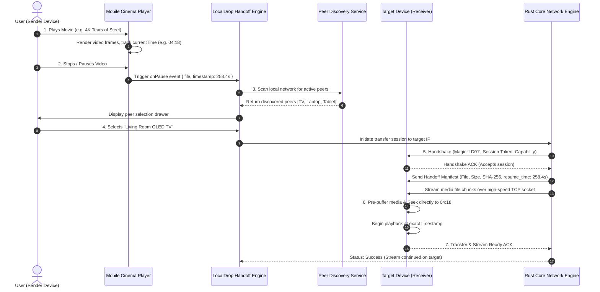

# LocalDrop — Product & System Guide

> **LocalDrop (Veltrix)** is a privacy-first, cross-platform peer-to-peer (P2P) file transfer and media streaming system. It combines a high-performance, memory-efficient **Rust core engine** with an intuitive **Mobile Cinema App** featuring seamless **stop-and-handoff media playback** across devices on a local area network (LAN).

---

## 1. Product Overview & Architecture

LocalDrop operates on an **Engine-First, Zero-Cloud** architecture. No data, metadata, or telemetry ever leaves your local network.

```
+-----------------------------------------------------------------------+
|                           PRESENTATION LAYER                          |
|  +--------------------------------+ +-------------------------------+ |
|  |   LocalDrop Mobile Web / PWA   | |     Flutter App (Native)      | |
|  | (Cinema Player & Stream Handoff| | (Future Native Android / iOS) | |
|  +--------------------------------+ +-------------------------------+ |
+-----------------------------------▲-----------------------------------+
                                    │ Local Bridge / FFI
+-----------------------------------▼-----------------------------------+
|                           RUST CORE ENGINE                            |
|  +-----------------------------------------------------------------+  |
|  | localdrop_cli: CLI runner, daemon controller, progress displays |  |
|  +-----------------------------------------------------------------+  |
|  | localdrop_core:                                                 |  |
|  |  * Protocol Framing (4-byte BE length prefix, 16 MiB max)        |  |
|  |  * Transport Layer (Async Tokio TCP / QUIC)                     |  |
|  |  * Streaming Transfer (Chunking, SHA-256 verification, Resume)   |  |
|  |  * Path Sanitizer (Traversal defense, Windows reserved names)   |  |
|  |  * Discovery Registry (mDNS / UDP beaconing)                    |  |
|  +-----------------------------------------------------------------+  |
+-----------------------------------------------------------------------+
```

---

## 2. Step-by-Step Lifecycle (What Happens on Each Step)

When you watch a video on a mobile device and hand off the stream to another device (such as a TV, tablet, or laptop), the system executes the following steps:



---

### Step 1: Media Selection & Local Playback
* **What happens in the UI**: The user browses the cinema catalogue or chooses a local video file. Tapping **Play** mounts the video stream into the hardware-accelerated video element.
* **What happens under the hood**:
  - The video element begins decoding the container (MP4/WebM) and extracts metadata (dimensions, framerate, total duration, audio channels).
  - An internal telemetry timer polls playback position (`currentTime`) at 60 Hz to drive the glowing custom scrubber and time indicators (`04:18 / 12:14`).

---

### Step 2: The Stop / Pause Trigger
* **What happens in the UI**: The user taps **Pause**, clicks the video surface, or presses the **"Stop & LocalDrop"** action button in the top navigation bar.
* **What happens under the hood**:
  - The player intercepts the HTML5 `pause` event.
  - The exact playback state is captured and frozen:
    ```json
    {
      "movieId": "tears-of-steel",
      "title": "Tears of Steel (4K)",
      "fileUrl": "https://commondatastorage.googleapis.com/.../tears_of_steel_1080p.mp4",
      "exactTimestampSeconds": 258.421,
      "formattedTimestamp": "04:18",
      "audioVolume": 1.0,
      "playbackRate": 1.0
    }
    ```
  - The bottom sheet drawer animates upward, presenting the frozen time badge (`Paused at 04:18`) and activating the radar scanner.

---

### Step 3: Peer Discovery & Subnet Radar
* **What happens in the UI**: A radar pulse animation ripples out, displaying nearby available devices on the local Wi-Fi network.
* **What happens under the hood**:
  - **mDNS Service Discovery**: Devices advertise their presence via multicast DNS (`_localdrop._tcp.local`) containing their device name, OS platform, and transfer port.
  - **UDP Beacon Fallback**: If mDNS is disabled or blocked by the router, devices periodically broadcast a lightweight UDP beacon on a designated subnet port.
  - **Local Subnet Scan**: The app queries the local network interface IP (e.g. `192.168.1.101`) and registers peer responses.
  - Each discovered peer is validated for:
    - IP Reachability and round-trip ping latency.
    - Signal quality indicator (e.g., `-42 dBm`, `5 GHz Wi-Fi`).
    - Device category icon (TV, Laptop, Phone, Tablet).

---

### Step 4: Device Selection & Session Negotiation
* **What happens in the UI**: The user selects a target peer (e.g., **"Living Room OLED TV"**).
* **What happens under the hood**:
  - The sender opens a direct TCP connection to the receiver's LocalDrop port.
  - **Protocol Handshake**:
    1. Sender transmits `HandshakeInit`: Magic bytes `LD01`, Protocol Version `1`, and an ephemeral Session UUID.
    2. Receiver verifies version compatibility, checks system load, and replies with `HandshakeAck`.
    3. If version or credentials mismatch, the connection is cleanly closed with an explanatory error code.

---

### Step 5: State & File Transfer Handoff
* **What happens in the UI**: The progress indicator displays the transfer speed, transferred megabytes, and remaining time.
* **What happens under the hood**:
  - The sender constructs a `TransferManifest` containing:
    - File filename, byte size, and expected SHA-256 hash.
    - Media playback handoff metadata: `{ resume_at_timestamp: 258.421, auto_play: true }`.
  - The file stream is transmitted in bounded chunks (e.g., 1 MB or 256 KB) using 4-byte big-endian length-prefixed framing.
  - Memory consumption is strictly bounded to $O(\text{chunk\_size})$—no multi-gigabyte files are ever buffered entirely into RAM.

---

### Step 6: Stream Continuation on the Target Device
* **What happens in the UI**:
  - The target device receives the incoming handoff request.
  - The media player automatically transitions from idle to active cinema mode.
  - Playback resumes seamlessly from the exact paused millisecond (`04:18`) without requiring the user to manually scrub or search for their place.
* **What happens under the hood**:
  - The receiver reads the `resume_at_timestamp` from the manifest.
  - The video element on the target device is loaded with the media source and issued a fast seek:
    ```javascript
    videoElement.currentTime = manifest.resume_at_timestamp;
    videoElement.play();
    ```
  - Audio and video pipelines re-synchronize, and playback continues uninterrupted.

---

### Step 7: Session Finalization & State Sync
* **What happens in the UI**: The sender displays a confirmation notification: *"Playback successfully transferred to Living Room OLED TV"*.
* **What happens under the hood**:
  - The receiver sends a `TransferComplete` acknowledgment frame back to the sender.
  - The sender resets its active transfer state, releases network sockets, and keeps its local copy in a paused/docked state to avoid duplicate audio playback.

---

## 2.1 Phone Server to TV Client Architecture (LocalDrop Cast & Shared Gallery)

In this mode, the **Phone acts as the local Media Server & Remote Control Hub**, while the **TV acts as the Screen Client & Receiver**.

```
+-----------------------------------------------------------------------------------------+
|                                    LOCALDROP CAST                                       |
|                                                                                         |
|  +-------------------------------------+            +--------------------------------+  |
|  |       PHONE (MEDIA SERVER)          |            |       TV (CLIENT SCREEN)       |  |
|  |  * Camera Roll / Gallery Storage    |            |  * 10-Foot Big Screen Receiver |  |
|  |  * Direct Video / Audio Access      |            |  * Hardware Video Decoder      |  |
|  |  * HTTP / TCP Stream Broadcaster    |===========>|  * Ambient Glow HUD Overlay    |  |
|  |  * Remote Controller (Seek/Pause)   |   78 MB/s  |  * Shared Phone Media Tray     |  |
|  |  * Live Video Switcher              |  LAN Stream|    (Browse phone clips on TV!) |  |
|  +-------------------------------------+            +--------------------------------+  |
+-----------------------------------------------------------------------------------------+
```

### The End-to-End Workflow:
1. **Device Media Access & Permissions**:
   - The user opens LocalDrop. The app requests device media storage permission (Audio, Video, Photos).
   - The user taps **"Add Videos"** or **"+ Pick Video"** to select any video directly from their phone's camera roll, download folder, or external SD card—**without needing to copy files into an isolated app silo**.
   - Dynamic canvas snapshotting generates instant video thumbnails and duration metadata.

2. **Connecting to the TV Screen**:
   - The user taps the **Cast Target Selector** in the app header and selects their TV (e.g., *Living Room Smart TV* at `192.168.1.105:8080`).
   - **Background Video Detection**:
     - **If a video is already running in background/foreground**: The app immediately casts the current video and begins streaming from the exact millisecond timestamp.
     - **If NO video is running**: The app prompts the user: *"Pick any video from your phone gallery to stream to Living Room Smart TV"*.

3. **Phone Gallery as "Shared Media Hub" on the TV**:
   - The TV screen renders a **"📱 Shared Phone Media Gallery"** tray right on the big screen!
   - Every video selected on the phone is visible on the TV screen with its title, thumbnail, duration, and resolution badge.
   - **Two-way Switching**:
     - **From Phone**: Tap any video in the phone's gallery list -> The TV instantly switches the stream to that video!
     - **From TV**: Select any video card in the TV carousel -> The TV starts playing that video, and the Phone's remote controller updates its "Now Playing" card in real-time!

4. **Real-Time Remote Control**:
   - The phone interface transforms into a sleek TV remote controller:
     - **Play / Pause** toggle with instant TV frame sync.
     - **Touch Scrubber**: Scrubbing the phone timeline seeks the TV playback in real time.
     - **Skip -10s / +10s**, **Next / Previous Video**, and **TV Audio Mute / Unmute**.
     - **Stop & Switch Device**: Pauses the TV and displays options to switch screens or pick another movie.


---

## 3. What Happens in "Other Things" (Deep Tech & Edge Cases)

### 3.1 Network Interruption & Disconnects
* **The Problem**: A user walks out of Wi-Fi range or the router glitches during a 4 GB movie transfer.
* **What LocalDrop Does**:
  1. The receiver detects the broken socket via TCP `FIN`/`RST` or a 10-second timeout.
  2. The partially received file is preserved on disk with a `.part` extension (e.g., `movie.mp4.part`).
  3. A binary resume manifest (`movie.mp4.part.manifest`) records a bitset of all valid chunks received and verified so far.
  4. When the connection re-establishes, the sender requests a `TransferResume` check. The receiver sends back its missing chunk list (`missing_chunks: [142, 143, ...]`).
  5. The sender only transmits the missing chunks. **Zero bytes of already-verified data are re-sent.**

---

### 3.2 Corrupted Data & Bit Rot Protection
* **The Problem**: Faulty Wi-Fi hardware or packet corruption flips bits during transit.
* **What LocalDrop Does**:
  - During transfer, the receiver computes an incremental SHA-256 hash on the incoming byte stream.
  - Individual chunks have CRC32/SHA-256 validation.
  - Upon completion, the overall file hash is compared against the sender's manifest hash.
  - If a mismatch occurs:
    - The file is **never renamed** to the destination filename (preventing corrupted files from polluting the user's filesystem).
    - The corrupt chunk is isolated and re-requested, or the transfer is safely aborted with a `ChecksumMismatch` error.

---

### 3.3 Wi-Fi Client Isolation (Guest Networks)
* **The Problem**: Some public, hotel, or enterprise Wi-Fi routers enable "AP Isolation" or "Client Isolation," preventing two wireless devices from communicating directly with each other.
* **What LocalDrop Does**:
  1. **Detection**: If mDNS multicast fails to discover any peers on the subnet despite active network interfaces, LocalDrop tests subnet gateway reachability.
  2. **Direct IP Entry**: Users can manually enter the target device's IP (e.g. `192.168.1.105:8080`) or scan a QR code shown on the receiver's screen.
  3. **Hotspot Mode Fallback**: If client isolation is insurmountable, the app guides the user to enable Wi-Fi Direct or a mobile hotspot, allowing direct peer-to-peer connectivity with maximum speed.

---

### 3.4 Memory Management & Backpressure
* **The Problem**: Sending a 50 GB Blu-ray file can exhaust system RAM if the entire file is buffered.
* **What LocalDrop Does**:
  - **Bounded Memory Footprint**: The Rust engine processes transfers in discrete chunks (default 1 MiB). Total memory consumption remains flat ($< 25\text{ MB}$ RSS), even on 100 GB files.
  - **I/O Backpressure**: Tokio async channels ensure the sender will not read from disk faster than the network socket can write, and the receiver will not read from the network faster than the disk can flush (`tokio::io::AsyncWriteExt::flush`).

---

### 3.5 Security & Path Traversal Sanitization
* **The Problem**: A malicious peer sends a file named `../../../../Windows/System32/evil.exe` or `CON.txt`.
* **What LocalDrop Does**:
  - All filenames pass through a strict sanitizer ([`crates/localdrop_core/src/transfer/state.rs`](file:///c:/Users/Abhijeet/Desktop/Veltrix/crates/localdrop_core/src/transfer/state.rs)):
    - Strips all directory separators (`/`, `\`) to prevent directory traversal.
    - Strips `..` and relative path segments.
    - Rejects Windows reserved names (`CON`, `PRN`, `AUX`, `NUL`, `COM1-9`, `LPT1-9`).
    - Enforces a clean base filename written exclusively into the designated download folder.

---

### 3.6 Does LocalDrop Need to Run 24/7 to Remember Stopped Videos?
* **The Question**: Does LocalDrop need to run 24/7 in the background or keep the phone awake just to remember where the video stopped?
* **Answer**: **NO. Absolutely not.**
* **How It Works**:
  1. **Instant On-Disk Persistence (Zero CPU / Zero Battery)**:
     - The moment you pause or stop a video (e.g. at `04:18`), LocalDrop writes an atomic state manifest to persistent disk storage (`localStorage` / SQLite / binary `.manifest`).
     - Once written to disk, the app does **not** need to stay awake or run in the background.
     - You can completely close the app, lock your phone, or turn off your device. When closed, it consumes **0% CPU, 0% RAM, and 0% Battery**.
  2. **Instant Re-hydration on Re-open**:
     - When you open LocalDrop again—whether 5 minutes or 3 weeks later—it reads the on-disk manifest in milliseconds:
       *"Tears of Steel — Stopped at 04:18. Resume locally or Stream to Living Room TV?"*
  3. **Streaming vs Transferring to TV**:
     - **In Live Cast Mode**: The phone only runs the Wi-Fi stream socket while actively playing. As soon as you pause, the connection closes and the phone can sleep immediately.
     - **In LocalDrop Transfer Mode**: The phone sends the full movie file to the TV (takes ~3.5 seconds over 78 MB/s Wi-Fi). Once transferred, the TV has the movie and the pause timestamp saved locally—you can turn off your phone completely and the TV will continue playing on its own!


---

## 4. Comprehensive Protocol State Machine

```
                      +-------------------+
                      |      IDLE         |
                      +---------+---------+
                                |
                   User taps "Play Video"
                                |
                                v
                      +-------------------+
                      |     PLAYING       |
                      +---------+---------+
                                |
               User taps "Pause" or "Stop Handoff"
                                |
                                v
                      +-------------------+
                      |  CAPTURE STATE    |  <-- Timestamp frozen (e.g. 04:18)
                      +---------+---------+
                                |
                      +---------v---------+
                      |   DISCOVERING     |  <-- mDNS / UDP radar scan
                      +---------+---------+
                                |
                       Select Target Peer
                                |
                                v
                      +-------------------+
                      |    HANDSHAKE      |  <-- Magic bytes 'LD01' + Session UUID
                      +---------+---------+
                                |
                           Handshake ACK
                                |
                                v
                      +-------------------+
                      | TRANSFER & STREAM |  <-- 4-byte BE framing + SHA-256
                      +---------+---------+
                                |
                      Stream Ready ACK
                                |
                                v
                      +-------------------+
                      | RESUMED ON TARGET |  <-- Playback continues seamlessly
                      +-------------------+
```

---

## 5. Repository Map & Key Components

| Path | Purpose |
| :--- | :--- |
| [`apps/localdrop_web/`](file:///c:/Users/Abhijeet/Desktop/Veltrix/apps/localdrop_web/) | Mobile cinema web application with auto-pause detection, peer drawer, and stream continuation. |
| [`crates/localdrop_core/`](file:///c:/Users/Abhijeet/Desktop/Veltrix/crates/localdrop_core/) | Core Rust networking engine: TCP transport, protocol framing, SHA-256 verification, and path sanitizer. |
| [`crates/localdrop_cli/`](file:///c:/Users/Abhijeet/Desktop/Veltrix/crates/localdrop_cli/) | CLI tool (`localdrop send`, `localdrop receive`) with live progress bars and socket listeners. |
| [`protocol/`](file:///c:/Users/Abhijeet/Desktop/Veltrix/protocol/) | Protocol specification documents: `framing.md`, `handshake.md`, `transfer.md`, `discovery.md`, `errors.md`. |
| [`benchmarks/`](file:///c:/Users/Abhijeet/Desktop/Veltrix/benchmarks/) | Performance measurements and empirical benchmarks (100 MB at 73.15 MB/s, 1 GB at 71.93 MB/s). |

---

## 6. How to Run & Validate

### 1. Launching the Mobile Web App
```bash
cd apps/localdrop_web
npm run dev
```
- Open `http://localhost:5173/` on your computer.
- Open `http://192.168.1.101:5173/` on any mobile phone or tablet connected to your Wi-Fi network.

### 2. Running the Rust Core CLI
```bash
# Terminal 1: Start receiver daemon
cargo run --release -p localdrop_cli -- receive --port 8080 --out ./inbox

# Terminal 2: Send file to receiver
cargo run --release -p localdrop_cli -- send 127.0.0.1:8080 ./path/to/movie.mp4
```

### 3. Running Engine Test Suite
```bash
cargo test -p localdrop_core --test e1_tcp_transfer
```
All 14 integration tests validate:
- 0-byte, 1-byte, and multi-megabyte transfers.
- Exact chunk boundary handling.
- Corrupted byte detection and rejection.
- Unexpected socket disconnect cleanup.
- Protocol version mismatch rejection.
