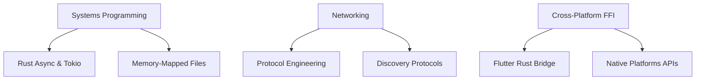

# LocalDrop Version 1.0 — Implementation, Testing & Learning Roadmap

This document outlines the detailed roadmap for building **LocalDrop Version 1.0**. It serves as a comprehensive developer guide detailing the scope, testing criteria, required components, and core learning outcomes of the project.

---

## 1. What is Included in Version 1.0?

Version 1.0 represents the first stable, production-ready release of LocalDrop. It contains the following features:

### 1.1 Core File Transfer Engine
*   **Dual-Transport Engine:** Production-ready **TCP** implementation with an evaluated **QUIC** integration.
*   **Application-Level Chunking:** Large files (up to 10GB+) split into configurable chunks for efficient transmission and progress reporting.
*   **Resumable Transfers:** Ability to automatically or manually resume interrupted transfers from the last successful chunk, using verification mapping.
*   **Zero-Copy Optimizations:** Platform-specific file reader/writer strategies including buffered readers and memory mapping (`mmap`).

### 1.2 Device Discovery & Identity
*   **mDNS Service Discovery:** Multicast DNS broadcasting on `_localdrop._tcp` for zero-configuration auto-discovery.
*   **UDP Fallback:** Direct UDP broadcast/unicast search if multicast is restricted.
*   **Manual IP Connection:** Direct IP input (e.g., `192.168.1.100:8080`) to bypass restrictive AP isolation configurations.
*   **Secure Device Identity:** Persistent, unique UUID device identities decoupled from hardware MAC addresses.

### 1.3 Security & Trust Architecture
*   **Explicit Device Pairing:** Consent-based pairing flow requiring approval on both devices before transmission begins.
*   **Encrypted Channels:** Secure channel establishment using authenticated encryption (e.g., TLS or Noise Protocol).
*   **Path Sanitization:** Absolute validation on the receiver side to prevent directory traversal and overwrite attacks.

### 1.4 Flutter Presentation Layer
*   **Responsive Multi-Platform UI:** Native-feeling interfaces for Desktop (Windows, macOS, Linux) and Mobile (Android, iOS).
*   **State Management:** Unified state representation powered by Riverpod, listening directly to async stream events pushed from Rust.
*   **Visual Assets & Indicators:** Clear progress bar, speed indicators (e.g., MB/s), remaining time estimation, and a transfer history log.

---

## 2. What Needs to Be Tested?

To ensure reliability, performance, and cross-platform consistency, the test suite must cover multiple levels:

### 2.1 Unit Testing (Rust Core)
*   **Protocol Parser:** Unit test all message serializations/deserializations (Handshake, Metadata, Accept, Chunk).
*   **Chunker Logic:** Verify that splitting a file into chunks and reconstructing it results in an identical byte stream.
*   **State Machine:** Test transitions (e.g., `QUEUED` ➔ `CONNECTING` ➔ `TRANSFERRING` ➔ `VERIFYING` ➔ `COMPLETED`).
*   **Checksumming:** Test that corrupt bytes injected into a chunk are caught by SHA-256 verification.

### 2.2 Integration Testing (Peer-to-Peer Simulator)
*   **Local Transfer Loop:** Automate a transfer where a mock sender crate and mock receiver crate communicate over a local loopback interface (`127.0.0.1`).
*   **Interruption Recovery:** Simulate a network drop mid-transfer, restore the connection, and assert that the file resumes from the correct chunk offset and passes hash checks.

### 2.3 Network Adversity & Stress Testing
*   **Latency & Packet Loss:** Test transfers using network simulation tools (like `tc-netem` on Linux or Clumsy on Windows) at:
    *   1% to 10% packet loss.
    *   50ms to 200ms latency.
*   **High Load:** Transfer multiple files concurrently. Test a single massive file (e.g., 20 GB) to verify memory usage remains constant (no memory leaks).

### 2.4 Manual & Multi-Platform Verification
*   **OS Interoperability:** Confirm transfers work flawlessly between different operating systems:
    *   Windows ➔ Android
    *   macOS ➔ iOS
    *   Android ➔ iOS
*   **UI Resiliency:** Verify that closing the app during a transfer cleanly aborts the native connection and saves the partial transfer state for later recovery.

---

## 3. What You Need to Build (Component Guide)

### 3.1 Crate: `localdrop_core` (Rust Engine)
You need to implement the following modules inside Rust:
1.  **`src/discovery/mdns.rs`:** Wrapper for advertising and browsing services using `astro-dns-sd` or `mdns-sd`.
2.  **`src/transport/tcp.rs`:** Asynchronous TCP socket reader/writer streams using Tokio.
3.  **`src/transfer/chunker.rs`:** Chunk layout compiler, file reader using `tokio::fs::File`, and `mmap` mapping logic.
4.  **`src/protocol/messages.rs`:** Handshake frames and metadata structs using `serde` (JSON or MessagePack binary format).
5.  **`src/security/identity.rs`:** Crypto-key generators and storage utils using the `ring` crate or `rustls`.

### 3.2 Flutter App: `localdrop_flutter` (Dart Interface)
You need to implement:
1.  **`flutter_rust_bridge` configuration:** Generate the FFI bindings mapping Rust structs directly into Dart.
2.  **Riverpod Providers:**
    *   `DeviceProvider`: Manages lists of active discovered peers.
    *   `TransferProvider`: Emits updates on active transfers, velocities, progress percentages, and current states.
3.  **App Screens:**
    *   `HomeScreen`: Search, discover, select target devices.
    *   `FilePicker`: Trigger native OS pickers to select files/folders.
    *   `TransferProgressView`: Display progress rings, speeds, ETAs, and Cancel controls.

---

## 4. What You Will Learn from Making This Project

Building LocalDrop is an excellent systems engineering exercise. Here are the core concepts you will master:

### 4.1 Advanced Asynchronous Rust & Tokio
*   **Tokio Runtime Architecture:** How to handle task spawns, selectors (`tokio::select!`), channels (`mpsc`, `oneshot`), and asynchronous network sockets.
*   **Zero-Copy File I/O:** Understanding the real-world performance differences between standard buffered filesystem access (`std::fs::File`), async tokio interfaces, and memory-mapped files (`memmap2` crate).

### 4.2 Network Protocol Design
*   **Custom Application Protocols:** How to design handshake sequences, define header framing, serialize stateful control packets, and handle variable network conditions.
*   **Reliability Over Unreliable Channels:** Implementing window-based packet validation, sequence numbering, and error-handling routines (especially when transitioning from TCP to QUIC/UDP).

### 4.3 FFI & Cross-Language Architecture
*   **Native Bridge Patterns:** Creating thread-safe API boundaries using `flutter_rust_bridge` to pass high-throughput data streams, structs, and status callbacks between the Dart VM and the Rust compiler.
*   **Concurrency Models:** Managing shared memory states and notifying the Flutter main UI thread using event streams without blocking the interface.

### 4.4 Mobile & Desktop Native OS API Integrations
*   **Android Service Lifecycle:** How to write background tasks and persistent foreground notifications to keep transfers alive even when the app is minimized.
*   **Desktop Integrations:** Interacting with OS firewalls, using system trays, and configuring network discovery capabilities on Apple Bonjour or Windows SSDP.
